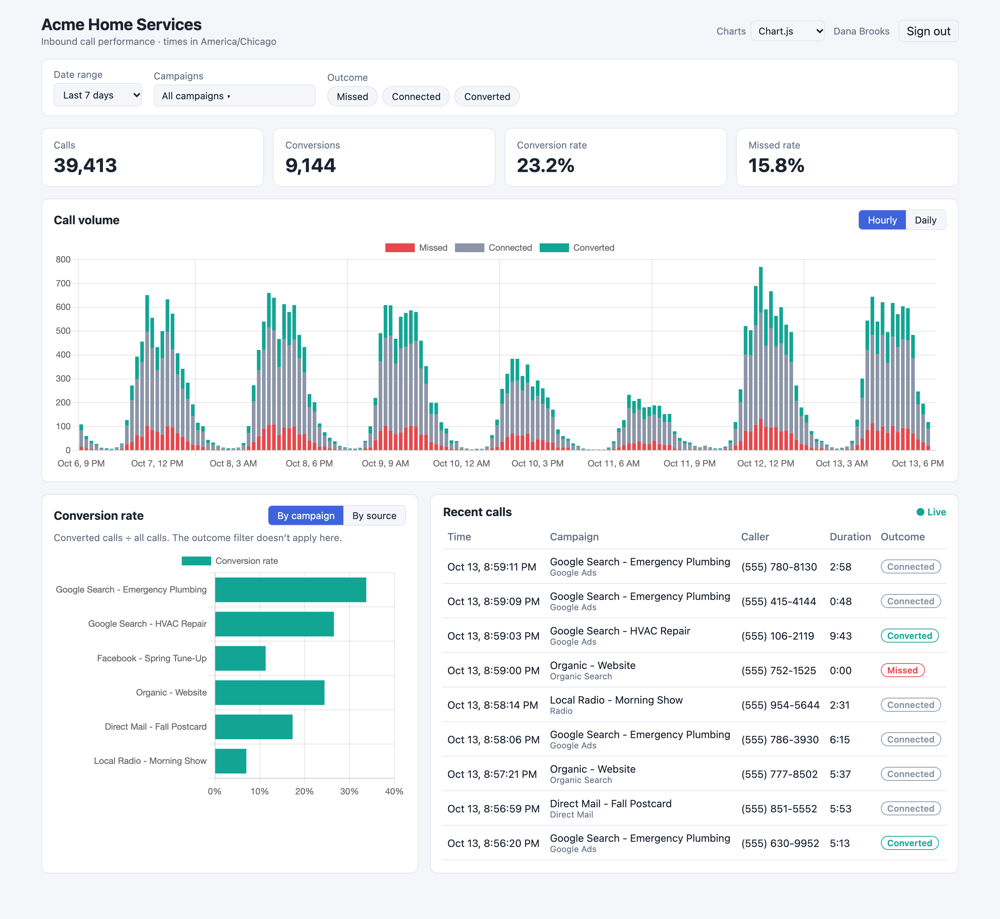

# Call Analytics Dashboard

A real-time dashboard that shows a marketing manager how their inbound calls are performing: call volume
over time (hourly and daily), conversion rate by campaign and by marketing source, a live feed of calls as
they happen, and filters by date range, campaign and outcome.



## Run it

Requires Docker only.

```bash
docker compose up --build
```

Open **http://localhost:1011** and sign in with a demo account (the login page has one-click buttons):

| Company | Email | Password | Timezone |
|---|---|---|---|
| Acme Home Services | `manager@acme.test` | `acme-demo` | America/Chicago |
| Summit Auto Group | `manager@summit.test` | `summit-demo` | America/New_York |

The first start migrates the database and generates **500,000 calls per company** over the last 90 days
(about 10 seconds, ~240 MB). After that, the simulator sends a new call roughly every 3 seconds and the
dashboard updates live.

- API docs (OpenAPI): http://localhost:8000/docs
- Simulator speed: `CALLS_PER_SECOND=2 docker compose up` (`0` pauses it)
- Ports already in use: `WEB_PORT=1012 API_PORT=8001 DB_PORT=5433 docker compose up`
- Start over with fresh data: `docker compose down -v`

### Tests

```bash
docker compose --profile test run --rm api-tests     # backend: 59 tests against a real PostgreSQL
cd frontend && npm install && npm test                # frontend: Vitest
```

## Running with 50 million calls per company

The default dataset is small on purpose: I didn't want to create a large database on your machine without
saying so up front. The design is meant for much more data, and you can try it:

```bash
docker compose down -v
SEED_CALLS_PER_ACCOUNT=50000000 docker compose up --build
```

That generates **100 million calls** (50M per company). Expect about **10 minutes** of seeding
and **20 GB** of disk. `5000000` (5M per company) is a middle ground.

Measured on a MacBook (Docker Desktop, 8 CPUs, 16 GB), Acme account, median of 5 runs
(`docker compose run --rm setup python -m scripts.benchmark`):

| Query (one company, 50M calls) | Raw `calls` table | Hourly rollup | Speedup |
|---|---:|---:|---:|
| Hourly volume, last 7 days | 1,510 ms | 0.7 ms | 2,197x |
| Daily volume, last 90 days | 21,811 ms | 4.6 ms | 4,732x |
| Conversion by campaign, last 30 days | 1,178 ms | 0.7 ms | 1,617x |

End to end through nginx and the API at 100M rows, every dashboard request answered in **under 10 ms**
(volume hourly 4 ms, volume daily over 90 days 9 ms, conversion 3 ms, recent calls 4 ms).

The raw-table numbers are what the dashboard would cost without the rollup table. With it, every
chart reads at most 24 rows per campaign per day, no matter how many calls there were.

## Decision summary

### What I built

- **Backend:** FastAPI + SQLAlchemy + Alembic on plain PostgreSQL 17 (nothing AWS RDS doesn't offer). Three read endpoints for
  the dashboard (volume, conversion, recent calls), a live stream (Server-Sent Events), login, and an
  ingestion endpoint for calls.
- **Data layer:** calls are partitioned into one table per day. The charts read an hourly rollup table
  that every insert keeps up to date, not the raw rows.
- **Real-time:** a simulator posts calls to the API like a telephony webhook would. The API stores each one,
  publishes it to Redis, and every API process pushes it to that company's open dashboards over SSE.
- **Multi-tenant:** two companies, shared tables with `account_id` on every row. The tenant comes from the
  login token or the API key, never from the request.
- **Frontend:** Vue 3 + Vite, served by nginx in its own container.

### Key trade-offs

- **Plain Postgres (RDS-compatible) over TimescaleDB.** I first built this on TimescaleDB, which gives
  partitioning and incremental rollups for free, but AWS RDS / Aurora don't offer it. A company on AWS is far
  more likely to run RDS, so I rebuilt it with native daily partitions and a rollup table updated in the same
  transaction as each insert. Same dashboard speed; the cost is that the rollup is our code, so a real
  deployment needs a nightly job that re-checks it against the raw calls.
- **SSE over WebSockets.** The dashboard only receives data. SSE is plain HTTP with automatic reconnect.
- **Redis pub/sub between the API and the browsers.** It lets the API run as several processes (or
  servers) and still deliver every event. In-process broadcasting would break with two instances.
- **Shared tables over a database per customer.** It's how most SaaS products start, and indexes that
  begin with `account_id` keep each customer's queries fast. It also leaves sharding by `account_id` open
  for later.
- **JWT in an httpOnly cookie.** The browser's `EventSource` can't send an `Authorization` header, and an
  httpOnly cookie keeps the token away from JavaScript.
- **The page updates every 10 seconds, feed included.** Re-querying aggregates on every call
  wouldn't scale with many open dashboards.

More detail on each decision: [docs/architecture.md](docs/architecture.md).

### Assumptions

- A call has one final outcome when it's reported: **missed** (not answered), **connected** (answered, no
  conversion) or **converted** (answered and led to a sale or booking).
- **Conversion rate = converted calls ÷ all calls.** The outcome filter doesn't apply to it, since a
  conversion rate over only missed calls is always 0%.
- Each campaign owns a tracking number; that's how a call is attributed to a campaign.
- "Real-time" means the whole page is at most 10 seconds behind. A steady 10-second rhythm is easier to
  read than numbers and rows changing every second.
- Daily numbers follow the company's own timezone, not UTC.

### What I'd do with more time

- **Scale-out story for 500 enterprise customers:** connection pooling (PgBouncer or RDS Proxy),
  `pg_partman` to create and drop partitions on a schedule, batched rollup updates if one row gets hot, read
  replicas for dashboards, then streaming calls into a columnar store (ClickHouse, Redshift) for analytics.
- **Calls in progress:** today a call appears when it ends, so long calls show up late. A "call started"
  event would let the feed show calls as they ring.
- **Product:** revenue per call, cost per call from ad spend, missed-call alerts, comparison with the
  previous period, CSV export.
- **Ops:** structured logs, metrics, tracing, rate limiting on ingestion.
- **Tests:** end-to-end browser tests (Playwright) and a load test on the stream endpoint.

### Intentionally left out

- Signup, password reset, user management, roles. Users and API keys are seeded.
- HTTPS (assumed to be done by a load balancer in front).
- Editing campaigns or tracking numbers.
- Late calls older than 3 days through the API: they go through the backfill path instead.

### How I used AI

I used Claude Code throughout. I made the decisions (stack, data model, tenancy, real-time approach,
auth, data volume) and Claude wrote most of the code to the conventions in
[docs/conventions.md](docs/conventions.md), which mirror the standards I use at work. I reviewed all of
it. **[Thiago: add which parts leaned most on AI and how confident you are extending them — the brief asks for this.]**

## Project layout

```
docker-compose.yml     db, redis, setup, api, simulator, frontend (+ api-tests profile)
backend/               FastAPI app, Alembic migrations, seeder, pytest suite, benchmark script
simulator/             sends fake calls to the API like a telephony provider
frontend/              Vue 3 + Vite app, Vitest tests, nginx config
docs/                  architecture, conventions, diagram
```
