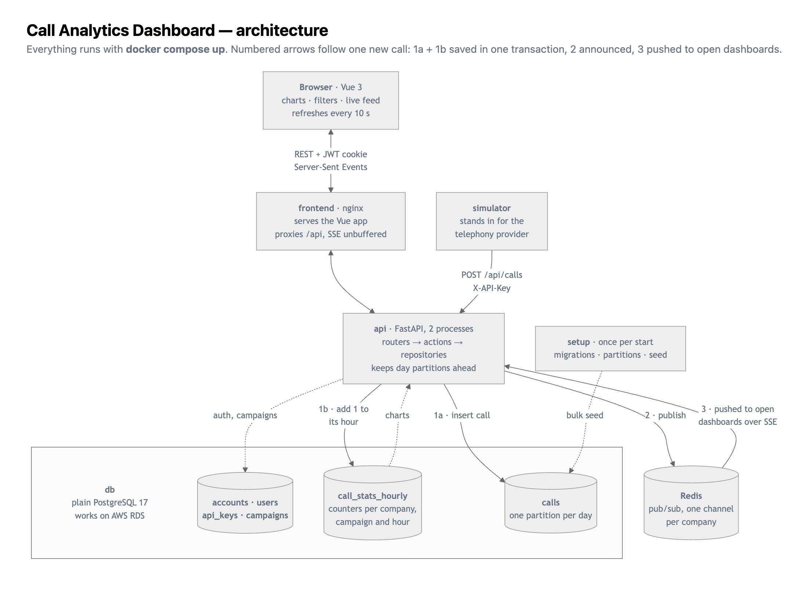

# Architecture

## The pieces

| Service | What it is | Why |
|---|---|---|
| `frontend` | Vue 3 + Vite, built to static files and served by nginx | nginx also proxies `/api`, so the browser talks to one origin: the session cookie works without CORS, and SSE goes through with buffering off. |
| `api` | FastAPI, 2 uvicorn worker processes | API-first, async, OpenAPI docs at `/docs`. Two workers on purpose: it proves live events reach a browser no matter which process handled the ingest. |
| `db` | Plain PostgreSQL 17, no extensions | The same engine you get on AWS RDS / Aurora. Daily partitions and an hourly rollup table keep the dashboard fast without anything RDS doesn't offer. |
| `redis` | Redis pub/sub | Fan-out of new calls to every API process. |
| `simulator` | A small Python service | Stands in for the telephony provider. Sends finished calls to `POST /api/calls`, the same way a webhook would. |
| `setup` | One-shot container | Runs the Alembic migrations, creates the daily partitions, then seeds demo data unless a finished seed is recorded. |

## Data flow

**Live path.** simulator → `POST /api/calls` (API key) → insert into `calls` and add 1 to its hour in
`call_stats_hourly`, in the same transaction → publish to Redis channel
`calls:<account_id>` → every API process receives it → pushed to that account's open browsers over
Server-Sent Events → the browser collects new calls and, every 10 seconds, adds them to the feed and refetches
the charts. The page says so at the top.

The publish happens after the commit and is best effort: if Redis is down, the failure is logged and the
call still returns `201`. The call is stored and counted; only the live push is lost, and the dashboard
shows it on its next refresh.

**Read path.** The charts read `call_stats_hourly`, never the raw table. The live feed reads the 50 calls
that ended most recently through the `(account_id, ended_at DESC)` index. It orders by `ended_at`, not
`started_at`, because a call is reported when it ends: a 10-minute call that just finished belongs at the top.

**Backfill path.** The historical seed skips the API and generates rows inside Postgres
(`INSERT … SELECT generate_series`), one day at a time, then rolls that day up into `call_stats_hourly`
with one `INSERT … SELECT … GROUP BY`. Each local day's hours are counted in UTC from local midnight to the
next local midnight, so the day daylight saving time starts has 23 hours and the day it ends has 25. When
every account is seeded, the seeder writes a row to `seed_runs`. If accounts exist without that row, an
earlier seed was interrupted: `setup` stops with an error asking for `docker compose down -v` instead of
deleting data or leaving a half-seeded database behind. Bulk backfill and live ingestion are separate paths
on purpose: loading millions of rows through HTTP would take hours.

## Data model

- `accounts` — the tenant. Holds the IANA timezone used to cut daily buckets.
- `users` — people who log in. Belong to one account.
- `api_keys` — machine credentials for ingestion. Only the SHA-256 of the key is stored.
- `campaigns` — each owns a tracking number. A call to that number belongs to that campaign, the way call
  tracking attributes calls.
- `calls` — one row per finished call, partitioned by `started_at` into one table per day (`calls_20261014`).
  `ended_at` (start + duration) is stored so the feed can sort by it with an index.
- `call_stats_hourly` — the rollup: one row per account, hour and campaign, with a counter per outcome and
  the total duration.
- `seed_runs` — one row once the demo seed has finished.

## Decisions and why

### Multi-tenancy: shared tables, `account_id` everywhere

Every tenant-owned table carries `account_id`, every hot index starts with it, and the API takes the
account only from the signed JWT or the API key, never from the URL. This is the pool model most SaaS
products use. A query for one account only reads that account's slice of the index, so a 100M-row table
behaves like a small one for a typical customer. It also makes sharding by `account_id` possible later
without a rewrite.

### Daily partitions + an hourly rollup table (plain Postgres, RDS-compatible)

The dashboard never scans raw calls for its charts. Two plain-Postgres features do the work, both available
on AWS RDS / Aurora:

- **Native partitioning, one partition per day.** "Last 7 days" only touches 7–8 partitions, and old data
  is dropped or archived a whole day at a time (`DROP TABLE calls_20260701`) instead of with a huge `DELETE`.
  `create_call_partitions(first_day, last_day)` creates them; `setup` runs it on every start, from the oldest
  seeded day to 30 days ahead, and every API process runs it once an hour from today to 30 days ahead, so
  the partitions stay ahead while the stack keeps running. The function takes an advisory lock, so the two
  workers never race, and skips days that already exist. A `calls_default` partition catches anything
  outside that range so an insert never fails. When a day's partition is created later, the function builds
  it as a standalone table, moves that day's rows out of `calls_default` into it, then attaches it. Attaching
  takes a lighter lock than `CREATE TABLE … PARTITION OF` and never fails on rows already in the default
  partition. On RDS, `pg_partman` + `pg_cron` could take over this job.
  The partitions are not in the models: `migrations/env.py` tells Alembic to skip the `calls_*` tables, so
  `alembic check` compares only what the models declare (the parent table, its indexes and identity column).
- **`call_stats_hourly`, a rollup table kept up to date on insert.** Every new call runs an upsert in the
  same transaction: insert the (account, hour, campaign) row or add 1 to its counters. The charts read at
  most 24 rows per campaign per day, and the numbers are exact the moment the call is committed. A late
  call simply adds 1 to an older hour.
- **Daily view = hourly rows re-bucketed in the account's timezone** with `date_trunc('day', bucket, tz)`.
  Works because the supported timezones have whole-hour offsets; a +05:30 zone would need 30-minute rows.
- **Trade-offs.** We own the rollup code: a bug or a manual `DELETE` on `calls` can make it drift, so a
  real deployment would add a nightly job that recomputes recent days from `calls`. At very high ingest,
  many calls updating the same (account, hour, campaign) row compete for its lock; the fix is to queue
  calls and apply the counts in batches every few seconds.
- **Why not TimescaleDB?** I first built this on TimescaleDB (hypertables + continuous aggregates). It
  worked well, but AWS RDS / Aurora and Google Cloud SQL don't offer it, and a company already on AWS is far
  more likely to run RDS than to add a new database vendor. Plain Postgres gives the same dashboard speed
  (see the benchmarks in the README).

### No foreign keys on `calls`

On a 100M-row table, foreign keys slow down every insert. The API is the only writer and validates
the account (API key) and the campaign (tracking number) on the way in.

### Idempotent ingestion

Telephony webhooks retry. `external_id` (the provider's call id) has a partial unique index
`(account_id, external_id, started_at)`, and the insert uses `ON CONFLICT DO NOTHING`. A retry returns
`200` with the stored call (and its own campaign), is not counted again in the rollup, and is not
re-published. A delivery that reuses an `external_id` and `started_at` with different data (tracking
number, outcome, duration or caller) is not a retry: it returns `409 Conflict` and the stored call is left
as it is. Postgres requires
the partition column in every unique index on a partitioned table; a genuine retry carries the same
`started_at`, so that's fine. A retry with a *different*
`started_at` would be stored twice — a known limitation.

Calls older than 3 days are rejected with `422`. A webhook that late is more likely a replay than a real
delivery; history goes through the backfill path.

### Real-time: SSE + Redis pub/sub

The dashboard only receives, so Server-Sent Events fit better than WebSockets: plain HTTP, automatic
reconnect, nothing to send back. Each API process holds **one** Redis subscription and fans events out to
its own browsers through in-memory queues. A browser that falls 100 events behind is disconnected instead of
growing memory; the browser reconnects (on its own after a network drop, with a 1–30 s backoff after an HTTP error) and the UI reloads the feed. If the Redis subscription
drops, the process closes it, subscribes again, and marks every browser it serves as behind: events
published during the gap are lost, so those browsers reconnect and reload instead of silently missing
calls. A heartbeat comment every
15 seconds keeps proxies from closing idle connections.

### Auth: people log in, machines use keys

- **Users:** email + password (bcrypt) → JWT in an **httpOnly cookie**. A cookie and not an
  `Authorization` header because the browser's `EventSource` can't send custom headers. httpOnly keeps the
  token away from JavaScript (XSS); `SameSite=Lax` blocks cross-site POSTs (CSRF). An unknown email is
  still checked against a fixed bcrypt hash, so response time doesn't reveal which emails are registered.
  Every request checks that the cookie's user still exists in its account (one primary-key lookup), so a
  deleted user gets `401` on every endpoint, not only `/me`, instead of reading stats until the cookie
  expires. The check uses its own short session, so the SSE stream doesn't hold a database connection while
  it stays open.
- **Secrets:** the demo JWT secret is only accepted when `ENVIRONMENT` is `local` (the default). With any
  other value the API refuses to start unless `JWT_SECRET` is set to something else.
- **Simulator:** an API key per account in the `X-API-Key` header.

### Filters

Date range, campaigns and outcomes apply to the volume chart and the feed. The **conversion rate ignores
the outcome filter**: a conversion rate over only missed calls is always 0% and means nothing. The UI says
so under the chart. Live calls are filtered in the browser, so changing a filter doesn't reopen the stream.

The charts and the feed read the date range differently, on purpose. The **charts count whole buckets**:
the range is widened to every hour (hourly view and conversion) or local day (daily view) it touches, in
one place (`Bucketing.covering`), because the rollup only knows whole hours and a bar for a partial hour
would look like a dip. The **feed uses the exact range**: it reads raw calls, so there is nothing to round.

## Code organization

See [conventions.md](conventions.md). Backend layers: routers (thin) → actions (business logic) →
repositories (one query each). Explanations live in this file, not in code comments.
